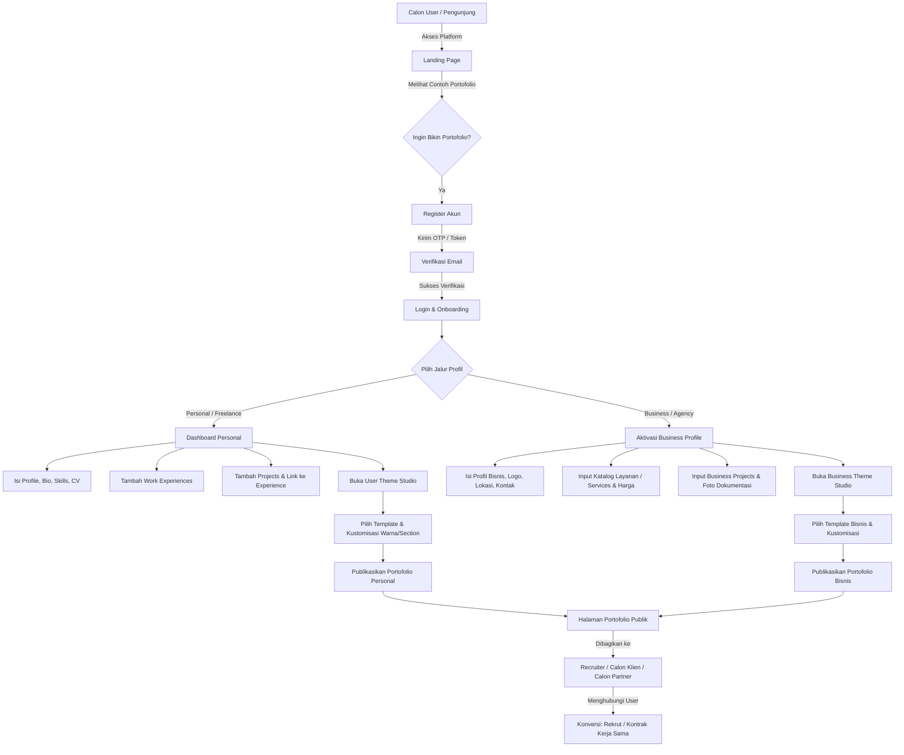
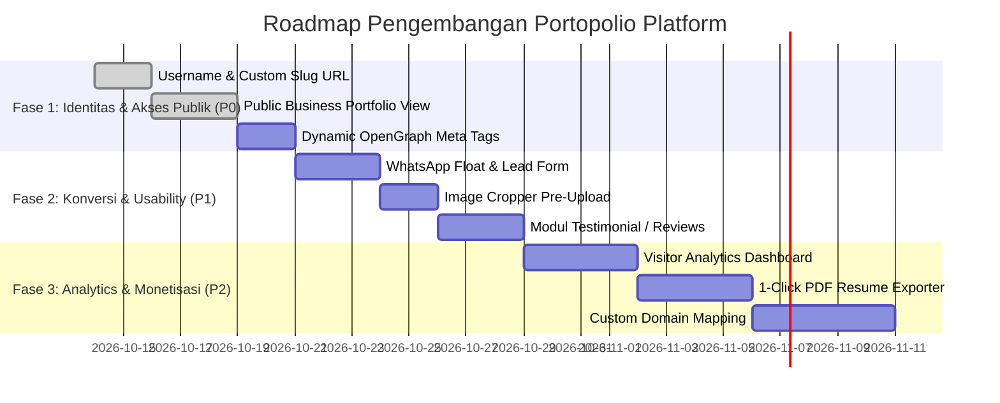

# 📄 Business Flow, Fitur Aplikasi, dan Roadmap Pengembangan

**Nama Proyek:** Portfolio & Business Profile Ecosystem (`portopolio-dev`)  
**Backend:** NestJS + Prisma ORM + PostgreSQL + Cloudinary  
**Frontend:** React 19 + TypeScript + Vite + Tailwind CSS v4 + Framer Motion  
**Terakhir Diperbarui:** 13 Oktober 2026  

---

## 1. Tentang Aplikasi Ini (Executive Summary)

### Apa Itu Aplikasi Ini?
Aplikasi ini adalah **All-in-One Portfolio & Business Profile Builder Platform** yang memungkinkan individu profesional (developer, desainer, freelancer) maupun entitas bisnis (agensi kreatif, studio, kontraktor, konsultan) untuk mengelola kredensial profesional mereka, memamerkan portofolio karya, dan mempublikasikannya dalam bentuk web portofolio interaktif yang modern, responsif, dan dapat dikustomisasi tampilannya.

### Untuk Siapa Aplikasi Ini? (Target Audiens)
1. **Talenta Individual & Profesional (Personal Tier)**
   - Software Engineer, UI/UX Designer, Product Manager, Freelancer, Creative Writer.
   - Kebutuhan: Menampilkan riwayat karier (experience timeline), tech stack yang dikuasai, tautan GitHub/Live Project, dan resume CV digital yang mudah dibagikan ke recruiter atau klien.
2. **Entitas Bisnis & Studio (Business Tier)**
   - Digital Agency, Design Studio, Kontraktor/Arsitek, Event Organizer, Jasa Konsultan.
   - Kebutuhan: Menampilkan profil perusahaan, katalog layanan (*services*) beserta estimasi harga mulai (*starting price*), dan portofolio proyek komersial (dengan metadata seperti tahun, nama klien, tipe proyek residensial/komersial/infrastruktur).
3. **Administrator Platform (Admin Tier)**
   - Pengelola ekosistem yang bertugas mendesain dan menerbitkan template dasar (*AST Blueprint Layouts*), memoderasi user, dan memantau performa platform.

### Masalah Utama yang Diselesaikan
* **Bagi Profesional & Freelancer:** Membuat portofolio dari nol memakan waktu berminggu-minggu (coding front-end, hosting, database). Platform portofolio biasa sering kali kaku dan tidak membedakan proyek pribadi dengan pengalaman kerja resmi.
* **Bagi Agensi & Studio Kecil:** Sewa website builder konvensional (WordPress, Wix) sering kali terlalu rumit, berat (*bloated*), dan sulit dikelola untuk kebutuhan *showcase* proyek murni.
* **Solusi Platform Ini:** Menyediakan struktur data portofolio yang rapi (terstandardisasi), didukung **Mesin Desain Tema Dinamis (AST Blueprint)** yang memisahkan data konten dengan tata letak visual, sehingga user bisa mengganti tema hanya dengan satu klik tanpa perlu coding ulang.

---

## 2. End-to-End Business Flow (Alur Bisnis)

### A. Diagram Alur Utama (High-Level Business Flow)

### B. Tahapan Alur Bisnis Detail

1. **Onboarding & Autentikasi Keamanan:**
   - User mendaftar menggunakan Email & Password.
   - Sistem mengirimkan email verifikasi otomatis. User tidak dapat mengakses modul portofolio sampai email berhasil diverifikasi (menjaga kualitas dan mencegah bot/spam).
   - Disediakan modul *Forgot Password* & *Reset Password* aman berbasis token kedaluwarsa.

2. **Branching Profil (Personal vs. Business):**
   - **Default:** Setiap user langsung memiliki akses ke profil personal (pengalaman kerja & proyek personal).
   - **Aktivasi Bisnis:** Jika user memiliki agensi/perusahaan, mereka dapat mengaktifkan *Business Profile* melalui modal aktivasi tanpa perlu mendaftar akun baru. Keduanya bisa hidup berdampingan dalam satu akun.

3. **Kurasi & Pengelolaan Konten (Content Authoring):**
   - User mengisi informasi profil, upload avatar/logo, dan banner (otomatis dioptimasi dan disimpan di Cloudinary).
   - Pengaturan visibilitas granular: Setiap kartu proyek atau pengalaman memiliki tombol *toggle* `isPublic`. User dapat mencicil draft portofolio secara privat sebelum siap dipamerkan ke publik.

4. **Kustomisasi Tema Dinamis (Theme Studio Engine):**
   - User tidak mendesain halaman dari nol, melainkan memilih template terbitan Admin (kategori: *Developer, Designer, Business, Minimal, Creative*).
   - User dapat menggeser urutan section (*drag and drop*), menyembunyikan section yang belum diperlukan, dan mengubah tema (warna primer, font, mode gelap/terang).

5. **Distribusi & Konsumsi Publik:**
   - Portofolio dapat diakses publik melalui tautan portofolio yang dapat disalin (*shareable link*).
   - Calon recruiter atau klien melihat tampilan portofolio yang sudah terkompilasi (*resolved*) secara responsif di perangkat mobile maupun desktop.

---

## 3. Katalog Fitur yang SUDAH SELESAI Didevelop (Status: Completed ✅)

Berikut seluruh fitur yang saat ini telah aktif di backend maupun frontend:

| Modul | Nama Fitur | Deskripsi Teknis |
| :--- | :--- | :--- |
| **Auth & Security** | Registrasi & Login JWT | Akses berbasis token JWT, autentikasi ganda untuk Role `USER` dan `ADMIN`. |
| | Verifikasi Email | Token verifikasi terenkripsi dengan masa kedaluwarsa via Nodemailer. |
| | Forgot & Reset Password | Alur pemulihan kata sandi dengan token aman via email. |
| **Personal Portfolio** | Manajemen Profil Lengkap | Input Nama, Headline, Bio, Lokasi, Kontak, Skills Array, Services, Upload CV URL. |
| | Experience Timeline | Manajemen riwayat karier (Perusahaan, Jabatan, Tanggal Mulai-Selesai, Logo, Deskripsi). |
| | Project Showcase | Manajemen proyek (Personal, Freelance, Work, Open Source) dengan tech stack tags, multi-image upload, dan link ke Experience. |
| **Business Profile** | Manajemen Profil Bisnis | Input Nama Bisnis, Deskripsi, Logo Perusahaan, Banner, Website, Lokasi, Kontak Bisnis. |
| | Business Services | Katalog layanan agensi dengan nama servis, deskripsi, dan harga mulai (*price start from*). |
| | Business Projects | Portofolio proyek komersial (Tipe: Residensial, Komersial, Industri, Renovasi, Desain Interior, dll.) dilengkapi tahun proyek dan nama klien. |
| **Theme & Layout Engine** | AST Blueprint Template | Penyimpanan struktur template dalam bentuk Abstract Syntax Tree (JSON Sections & Theme Tokens). |
| | Admin Template Builder | Admin dapat membuat template baru, mengatur section blocks (`HERO_PROFILE`, `PROJECT_LIST`, `EXPERIENCE_TIMELINE`, dll.), dan menerbitkan template. |
| | User Theme Studio | User dapat memilih template, toggle visibilitas section, kustomisasi palet warna, dan memilih font. |
| | Layout Resolver (`resolveLayout`) | Algoritma penggabungan cerdas di backend yang menggabungkan base template dengan kustomisasi user. |
| **Media Management** | Integrasi Cloudinary | Upload single & multi gambar untuk foto profil, banner, logo bisnis, dan dokumentasi proyek. |
| | Storage Auto-Cleanup | Penghapusan otomatis file gambar lama di Cloudinary saat user mengganti gambar baru (mencegah file sampah). |
| **Admin Backoffice** | Dashboard & Diagnostics | Overview statistik user dan diagnostik sistem (status DB, Mailer, Cloudinary). |
| | Manajemen Pengguna | Admin dapat melihat dan mengelola akun pengguna terdaftar. |

---

## 4. Analisis Kekuatan Sistem (Strengths & Solid Foundations)

1. **Arsitektur Dual Persona yang Bersih:** Database Prisma memisahkan tabel `Profile` dan `BusinessProfile`, memungkinkan pengembangan fitur spesifik untuk masing-masing tipe tanpa saling merusak skema data.
2. **Mesin Desain AST yang Sangat Skalabel:** Tidak ada *hardcoded layout* kaku. Menambah blok baru hanya membutuhkan definisi tipe blok baru di JSON blueprint.
3. **Penyimpanan Teroptimasi:** Logika penghapusan otomatis aset Cloudinary membuktikan standar arsitektur backend yang memperhatikan efisiensi biaya infrastruktur.
4. **Keamanan Data & Privasi Konten:** Penggunaan flag `isPublic` di seluruh level entitas (profil, layanan, proyek, pengalaman) memberikan kendali privasi penuh kepada user.

---

## 5. Fitur yang Memerlukan PENGEMBANGAN (Enhancements 🔄)

Fitur-fitur ini alur dasarnya sudah ada, namun perlu disempurnakan agar *user experience* dan performa produk naik kelas:

### 1. Custom Vanity URL / Handle (Pengganti UUID)
* **Kondisi Saat Ini:** Link portofolio publik masih berupa UUID (contoh: `/portfolio/9b1deb4d-3b7d-4bad-...`).
* **Kebutuhan Pengembangan:** Tambahkan field unik `username` atau `slug` pada profil personal dan bisnis (contoh: `/azka` atau `/@kreatif-studio`). Link ini jauh lebih ramah pengguna saat disematkan di bio LinkedIn atau CV fisik.

### 2. Dedicated Public Portfolio View untuk Profil Bisnis
* **Kondisi Saat Ini:** Endpoint publik portofolio saat ini baru me-resolve data personal (`Profile`, `Experience`, `Project`).
* **Kebutuhan Pengembangan:** Sediakan endpoint publik dan halaman tampilan khusus yang me-render profil bisnis lengkap (`BusinessProfile` + `BusinessServices` + `BusinessProjects`) menggunakan tema bisnis yang dipilih.

### 3. Pre-Upload Image Cropper & Aspect Ratio Guard
* **Kondisi Saat Ini:** File gambar yang dipilih langsung diunggah mentah ke Cloudinary tanpa pemotongan.
* **Kebutuhan Pengembangan:** Sediakan komponen modal *image cropper* di frontend sebelum upload (mengunci rasio 1:1 untuk Avatar/Logo, 16:9 atau 3:1 untuk Banner, dan 4:3 untuk Project Thumbnail) agar tampilan website user selalu simetris dan rapi.

### 4. Block-Level Props Customization pada Theme Studio
* **Kondisi Saat Ini:** Theme Studio baru mendukung kustomisasi tema umum (warna, font) dan toggle visibilitas.
* **Kebutuhan Pengembangan:** Berikan pengaturan spesifik untuk setiap blok section (misal: Section Hero bisa memilih varian *Center Aligned* atau *Split Banner*; Section Project bisa memilih tampilan *Grid 2-Column*, *Grid 3-Column*, atau *List View*).

### 5. Dynamic OpenGraph (OG) & Social Sharing Meta Tags
* **Kondisi Saat Ini:** Belum ada konfigurasi preview media sosial dinamis saat link portofolio dibagikan.
* **Kebutuhan Pengembangan:** Generate tag HTML OpenGraph dinamis (judul: `[Nama] - [Headline]`, deskripsi bio, dan gambar preview portofolio) agar saat link dikirim via WhatsApp, Twitter, atau LinkedIn muncul kartu preview yang mewah.

---

## 6. Fitur TAMBAHAN Baru yang Sangat Krusial (Missing Gaps & Game Changers 🚀)

Fitur-fitur berikut belum ada sama sekali, namun merupakan faktor penentu apakah portofolio user menghasilkan peluang nyata (*conversion*):

### A. Lead Generation & Konversi Klien
1. **Interactive "Hire Me / Request a Quote" Modal Form**
   - Pengunjung portofolio dapat langsung mengirim pesan tawaran proyek atau pekerjaan melalui formulir terintegrasi (Nama, Email Pengirim, Estimasi Budget, Pesan).
   - Pemilik portofolio menerima notifikasi instan via email.
2. **Floating "Quick WhatsApp Chat" Button**
   - Tombol mengambang di sudut bawah portofolio publik yang langsung menghubungkan pengunjung ke nomor WhatsApp pemilik portofolio dengan teks pembuka otomatis:
   - *"Halo [Nama], saya melihat portofolio Anda di [Link] dan tertarik untuk mendiskusikan peluang proyek..."*

### B. Kredibilitas & Bukti Sosial (Social Proof)
3. **Modul Testimonial & Client Reviews**
   - Tambahan skema data `Testimonial`: Nama Klien, Nama Perusahaan, Foto/Avatar, Rating Bintang (1–5), dan Kutipan Ulasan (*Quote*).
   - Menjadi blok section baru di Theme Builder (`TESTIMONIALS_CAROUSEL`) untuk meningkatkan kepercayaan calon klien.
4. **Actionable Call-to-Action (CTA) Bar**
   - Tombol aksi kustom seperti *"Download Resume (PDF)"*, *"Jadwalkan Diskusi (Integrasi Cal.com / Calendly)"*, atau *"Lihat Proposal Perusahaan"*.

### C. Retensi Pengguna & Analisis Kunjungan
5. **Visitor & Engagement Analytics Dashboard**
   - Menjawab pertanyaan krusial user: *"Apakah portofolio saya ada yang membuka?"*
   - Metrik yang dicatat:
     - Total kunjungan halaman (*Pageviews & Unique Visitors*).
     - Jumlah klik pada tautan kontak, tombol WhatsApp, link GitHub, dan unduhan CV.
     - Sumber asal pengunjung (*Referrer Traffic*: dari LinkedIn, Instagram, Google, Direct).

### D. Fitur Utilitas & Komersialisasi
6. **One-Click Export to ATS Resume & Company Profile PDF**
   - Karena data riwayat kerja, proyek, dan skill sudah tersimpan terstruktur di database, sediakan fitur 1-klik untuk mengunduh resume format PDF berstandar ATS ramah HRD, atau Company Profile 1-halaman untuk profil bisnis.
7. **Custom Domain & CNAME Mapping (Tier Pro)**
   - Kemampuan bagi user untuk menyambungkan domain milik sendiri (contoh: `www.azkadev.com` atau `portfolio.studioarsitek.id`) mengarah ke halaman portofolio mereka.
8. **Public Explore & Showcase Directory (Marketplace Ekosistem)**
   - Halaman `/explore` di platform utama yang memamerkan portofolio-portofolio terpilih. Berfungsi sebagai etalase talenta dan sumber backlink SEO organik bagi platform.

---

## 7. Roadmap & Prioritas Implementasi

### Matriks Prioritas Kerja:

| Tingkat Urgensi | Item Pekerjaan | Nilai Bisnis / Dampak Pengguna |
| :--- | :--- | :--- |
| **P0 (Harus Ada Segera)** | **Custom Slug / Username (`/@nama`)** | Mengubah link acak UUID menjadi link profesional yang layak dicantumkan di CV. |
| **P0 (Harus Ada Segera)** | **Public Business Portfolio Endpoint** | Melengkapi siklus fitur profil bisnis agar halaman bisnis dapat diakses oleh publik. |
| **P0 (Harus Ada Segera)** | **Dynamic Social Sharing Preview (OG)** | Memastikan link yang disebar di media sosial menampilkan kartu banner visual yang elegan. |
| **P1 (Penting)** | **Direct WhatsApp Button & Lead Form** | Mengubah pengunjung biasa menjadi calon prospek pekerjaan/proyek nyata (*lead capture*). |
| **P1 (Penting)** | **Image Cropping Helper** | Mencegah tampilan layout berantakan akibat rasio foto yang tidak konsisten. |
| **P1 (Penting)** | **Modul Testimonial Klien** | Meningkatkan daya jual dan kredibilitas agensi maupun freelancer. |
| **P2 (Nilai Tambah & Monetisasi)**| **Visitor Analytics Dashboard** | Memberikan kepuasan dan wawasan data kepada user mengenai performa portofolio mereka. |
| **P2 (Nilai Tambah & Monetisasi)**| **1-Click PDF Resume Exporter** | Menjadikan platform ini solusi lengkap pencarian kerja (web portofolio + PDF CV). |
| **P2 (Nilai Tambah & Monetisasi)**| **Custom Domain Mapping** | Potensi monetisasi utama untuk model langganan berbayar (*Subscription/Pro Plan*). |

---

*Dokumen ini dirancang sebagai acuan tunggal (*Single Source of Truth*) arah pengembangan produk, arsitektur teknis, dan prioritisasi backlog tim pengembang.*
